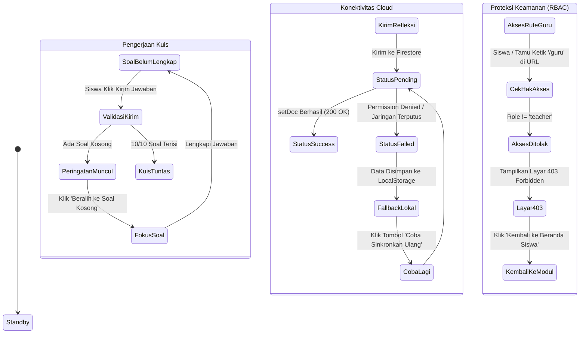

# ALUR PENGGUNA & STATE DIAGRAM (CHEMIFY)

Dokumen ini memetakan seluruh alur interaksi pengguna (*user journey*), diagram transisi status (*state transitions*), serta mekanisme penanganan skenario khusus (*edge cases*) pada platform **CHEMIFY**.

---

## 🗺️ 1. Peta Navigasi & Diagram Alur Pengguna Utama

```mermaid
flowchart TD
    Start([Pengguna Masuk ke Website CHEMIFY]) --> Choice{Pilihan Akses}
    
    Choice -->|Klik 'Masuk sebagai Tamu'| GuestMode[Mode Belajar Tamu (Local Storage Only)]
    Choice -->|Sudah Memiliki Akun| Login[Halaman Login Terpadu (Tanpa Banner Khusus)]
    Choice -->|Pengguna Baru| Register[Halaman Registrasi (Default Role: Student)]
    
    Register -->|Registrasi Sukses| Login
    
    Login --> AuthCheck{Autentikasi & Verifikasi Role Firebase}
    AuthCheck -->|Role: Student| StudentDash[Dashboard Siswa / Modul 5E]
    AuthCheck -->|Role: Teacher (Auto-Detect Email/Firestore)| TeacherDash[Portal Guru / Dashboard Pendidik]
    
    GuestMode --> Stage1[Tahap 1: Engage]
    StudentDash --> Stage1
    
    Stage1 -->|Input Prediksi Apersepsi| Stage2[Tahap 2: Explore]
    Stage2 -->|Simulasi Lab pH & Visualisasi Ion| Stage3[Tahap 3: Explain]
    Stage3 -->|Mempelajari Konsep & Teori Asam-Basa| Stage4[Tahap 4: Elaborate]
    Stage4 -->|Analisis Kasus Kontekstual| Stage5[Tahap 5: Evaluate]
    
    Stage5 --> QuizCheck{10 Soal Lengkap Terjawab?}
    QuizCheck -->|Belum Lengkap| IncompleteModal[Modal Peringatan & Jump to Unanswered]
    IncompleteModal --> Stage5
    QuizCheck -->|Lengkap (10/10)| SubmitQuiz[Kirim Evaluasi & Hitung Skor]
    
    SubmitQuiz --> Results[Halaman Hasil & Refleksi Belajar]
    Results --> SaveRef{Simpan Refleksi}
    
    SaveRef -->|Pengguna Tamu (Ditolak dari Cloud)| LocalSave[Hanya Disimpan di LocalStorage chem_guest_*]
    SaveRef -->|Siswa Terdaftar| CloudSync[Sinkronisasi Cloud Firestore]
    
    LocalSave --> TamuPrompt[Banner Ajakan Registrasi Akun]
    CloudSync --> StatusFeedback[4 Status Feedback: local, pending, success, failed]
```

---

## 👤 2. Rincian Alur Berdasarkan Peran Pengguna

### A. Alur Pengguna Tamu (Mode Belajar Tanpa Login Awal — 05-06)
1. **Titik Masuk:** Pengguna mengakses halaman beranda atau halaman login terpadu.
2. **Pilihan Tamu:** Pengguna mengeklik tombol *"Masuk sebagai Tamu"* (dengan penanda mode tanpa akun).
3. **Inisialisasi Sesi:**
   - Sesi disetel dengan `isGuest: true`, `name: 'Siswa Tamu'`, dan `role: 'guest'`.
   - Sesi disimpan secara aman di `sessionStorage` (tanpa jejak akun di `localStorage`).
   - Kunci penyimpanan lokal menggunakan *namespace* terpisah: `chem_guest_*`.
4. **Pembelajaran 5E:** Pengguna tamu dapat mengakses seluruh tahapan 5E dan simulasi laboratorium virtual tanpa hambatan.
5. **Halaman Hasil & Proteksi Data Cloud:**
   - Draf dan hasil kuis disimpan di penyimpanan lokal perangkat (`chem_guest_*`).
   - Seluruh data tamu (progres, refleksi, evaluasi kuis) diblokir dari pengiriman atau penyimpanan ke Firebase Firestore.
   - Ditampilkan banner edukatif: *"Anda sedang belajar dalam Mode Tamu. Progres Anda tersimpan di peramban ini. Daftarkan akun untuk menyimpan portofolio belajar permanen."*
6. **Proteksi:** Jika pengguna tamu mencoba membuka `/guru`, sistem langsung memblokir dan menampilkan layar *403 Forbidden*.

---

### B. Alur Siswa Terdaftar (Authenticated Student)
1. **Registrasi:** Siswa mengisi nama lengkap, email (@example.invalid untuk pengujian), sekolah, kelas, password, dan konfirmasi password.
2. **Penetapan Role Otomatis:** Akun baru secara otomatis memperoleh `role: 'student'`.
3. **Login:** Siswa masuk menggunakan email dan kata sandi yang telah didaftarkan. Opsi *"Ingat Saya (Remember Me)"* mengontrol durasi penyimpanan sesi.
4. **Isolasi State (05-03):** Progres akun sebelumnya dibersihkan dari memori. Sistem memuat progres khusus siswa dari `chem_<uid>_*` atau Cloud Firestore.
5. **Siklus 5E:**
   - **Engage:** Memilih prediksi apersepsi (dapat difokuskan via keyboard Tab — 05-09).
   - **Explore:** Menggeser slider konsentrasi larutan, mengamati perubahan warna skala pH dan visualisasi ion $\text{H}^+$ / $\text{OH}^-$.
   - **Explain:** Membaca kartu konsep teori Arrhenius, Brønsted-Lowry, dan Lewis.
   - **Elaborate:** Mengerjakan analisis kontekstual pengasaman laut dan zat rumah tangga.
   - **Evaluate:** Mengerjakan 10 soal kuis pilihan ganda. Draf jawaban dan posisi nomor soal otomatis dipersistensikan jika siswa me-refresh browser (05-08).
6. **Penyelesaian Kuis (05-05):** Siswa wajib mengisi seluruh 10 soal sebelum dapat mengirimkan jawaban. Skor dihitung secara pasti terhadap skala 100.
7. **Refleksi & Hasil Belajar (05-02 & 05-07):**
   - Siswa mengisi catatan refleksi pembelajaran.
   - Data tersimpan secara parsial ke Firestore tanpa menghapus progres tahapan 1–5.
   - Indikator antarmuka menampilkan status sinkronisasi cloud (`success`, `pending`, `failed`) secara faktual.

---

### C. Alur Pendidik / Guru (Teacher Role)
1. **Login Guru:** Pengguna masuk menggunakan email guru:
   `karenina.zulfa.2403316@students.um.ac.id` melalui form login terpadu. Banner/tombol terpisah "Portal Guru" telah dihapus dari halaman login dan registrasi agar autentikasi berlangsung terpusat.
2. **Verifikasi RBAC:** Sistem memeriksa kecocokan email dan atribut `role === 'teacher'` di Firebase/database.
3. **Pengalihan Otomatis:** Setelah berhasil login, guru langsung diarahkan secara otomatis ke **Teacher Dashboard** (`/guru/dashboard`).
4. **Aktivitas di Teacher Dashboard:**
   - **Ringkasan Statistik:** Memantau total siswa terdaftar, rata-rata skor kuis, dan jumlah siswa yang tuntas 5 tahap 5E.
   - **Tabel Monitoring Siswa:**
     - Mencari siswa berdasarkan nama, email, atau sekolah.
     - Memfilter siswa berdasarkan tingkatan kelas (X, XI, XII).
     - Melihat progres persentase 5E dan nilai evaluasi kuis siswa.
     - Membuka modal detail aktivitas siswa (melihat prediksi awal dan refleksi siswa).
   - **Analisis Butir Soal (05-04):** Menganalisis daya serap konsep pada masing-masing dari 10 butir soal kuis (tingkat akurasi $\ge 75\%$, $50-74\%$, $< 50\%$).
   - **Pratinjau Modul Siswa (*Preview Mode*):** Guru dapat menguji alur 5E dan simulasi laboratorium virtual seperti tampilan yang dilihat siswa.
   - **Kelola Profil Guru:** Mengubah data diri pendidik, nama sekolah, dan mata pelajaran di `/guru/profil`.
5. **Responsivitas Seluler (05-10):** Saat guru membuka portal menggunakan smartphone dengan lebar layar sempit ($375\text{px}$), tabel terisolasi dalam wadah gulir horizontal yang rapi dan kartu statistik tertata secara vertikal tanpa pemotongan konten.

---

## ⚡ 3. Penanganan Skenario Khusus & Edge Cases



### Matriks Penanganan Kondisi Khusus

| Skenario | Kondisi Pemicu | Respon Sistem CHEMIFY |
|---|---|---|
| **Siswa Me-refresh Halaman Kuis** | Tombol refresh ditekan di tengah pengerjaan soal nomor 7 | Draf jawaban soal 1–6 dan nomor aktif (soal 7) dipulihkan otomatis dari `chem_<uid>_quiz_draft`. Tidak ada data yang hilang. |
| **Siswa Mengirimkan Kuis Tidak Lengkap** | Hanya 8 dari 10 soal yang terjawab | Muncul peringatan `.quiz-incomplete-warning-box` yang menyebutkan butir soal yang belum diisi. Tombol navigasi langsung memindahkan fokus ke soal tersebut. |
| **Penyimpanan Browser Penuh** | Memori *LocalStorage* mencapai limit kuota (*QuotaExceededError*) | Fungsi pelindung `safeLocalStorageSet` menangkap galat, mencatat pesan peringatan di konsol, dan mempertahankan state di memori aplikasi tanpa memicu *crash*. |
| **Kegagalan Izin Firestore** | Firestore menolak penulisan refleksi (*permission-denied*) | Lencana status beralih ke `failed`, menampilkan pesan galat spesifik dan tombol *Retry Cloud Sync*. Data tetap tersimpan di penyimpanan lokal. |
| **Akses Ilegal ke Rute Pendidik** | Pengguna dengan role `student` atau `guest` mengetik `/guru` di URL | *Route Guard* memblokir render portal guru dan langsung menampilkan layar *403 Akses Ditolak* dilengkapi tombol kembali ke modul siswa. |
